# PsiWeb

[](https://buymeacoffee.com/danedge)

A web browser for the **Psion Series 5mx**, the **netBook** and the **Series 7** (in colour on the last two, at 640x480). Its engine is [Links 2](http://links.twibright.com/) (2.30, graphics mode), built with the 1999 EPOC R5 toolchain. It runs on the suite's shared networking ([psion-core](https://github.com/danieledge/psion-core), this repository's `core/` submodule): the same Wi-Fi modem or dial-up link as PsiTerm and PsiMail, and the suite's own TLS 1.3 client for HTTPS.

- Pages are plain documents: Links has **no CSS and no JavaScript**. Simple sites read well; big modern home pages come out as long lists.
- Pictures (JPEG, PNG, GIF) are fetched **on every page on a netBook with a network card**, and **only when asked** over a modem: View > Show pictures (Ctrl+I) for the page showing, or Tools > Preferences > Pictures.
- **No helper needed.** PsiWeb fetches pages itself (Direct), with its own TLS 1.3 and certificate checks; the Atom modem helper and PsiProxy on a computer are optional ways to make pages lighter (see *Ways to connect*).
- A new user is asked once how the Psion goes online (*Set up PsiWeb*); a page that cannot be opened says why and what to do.
- Links are underlined, since blue is all but black in 16 greys.
- PsiWeb starts on a built-in welcome page, without dialling.
- On the netBook, pages and pictures are in colour, and a toolband along the top has Back, Forward, Reload, Stop, Home, the address and a progress bar (see *On the netBook*).

Up to 0.61 the engine was NetSurf. Its sources are still in the tree as a fallback (see *The NetSurf engine* below), until Links has been proved on the device. The whole port is described in [`links/PORTING.md`](links/PORTING.md).

**Status: beta (1.04).** The exact ARM code that goes into `psiweb.exe` runs in an ARM emulator harness, and the whole package runs in a 5mx emulator (see *Testing*). It has not yet been timed on a real 5mx. Bug reports are welcome via [GitHub issues](https://github.com/danieledge/psiweb/issues).

[](https://github.com/danieledge/psiterm/raw/main/dist/PsiWeb.sis)

## What's new in 1.04

psion-core 959b8fd's Psion Internet fixes, the same as PsiMail 1.17's and
PsiTerm 1.24's:

- **A server that refuses the connection** no longer holds the next one off
  for 8 seconds: the link is up, so the next page or picture goes out at once.
- **A redial after a hang-up** sends the start command (ATD777 for the
  PsiConnect Atom) as the first dial does, instead of NetDial's own modem
  script, which the Atom answers with NO CARRIER.
- **Through the Atom modem**, Coda's toolbar shows Online while PsiWeb's
  call is up.

## What's new in 1.03

From Dan's evening with BBC News on his netBook:

- **The toolband, redrawn.** Back, Forward, Reload and Start side by side,
  then the address, then the padlock and Pictures side by side, with the
  same gap each side of the address. The pictures are drawn to one grid, so
  each sits in the middle of its button alike, in Coda's colours; Back and
  Forward turn grey when there is no page to go to; the address has a plain
  frame the buttons' height; the progress along its foot is in the
  highlight colour.
- **Page styles that earn their names.** Lighter puts a site's menus and
  footer in one line of links each, so a news site's headlines start on the
  first screen. Text only and Lighter no longer show the words a site
  hides for screen readers ("Attribution", "Posted", "9 hours ago", a
  video's headline twice), nor a news photo's description. Reader on a page
  of headlines shows it as Text only does, and says so, instead of leaving
  only the section headings.
- **View > Page style and Shift+Ctrl+R change the page showing at once.**
  Links handed back the page as it was already laid out, so a new style
  showed only on the next page (on the netBook, which keeps laid-out pages);
  Show the rest did the same.
- **Fetched without PsiProxy**, the first big page in Full or Lighter brings
  a one-time offer of Text only; Set up PsiWeb's Pages page says so too.
- **Set up PsiWeb** asks about pages crossing the network unencrypted only
  when PsiProxy on a computer is new to the settings, in a dialog with the
  explanation in it. A new web helper (Direct, the Atom's, PsiProxy) is
  taken by the running browser engine at once, so the page, Back and the
  connection stay; the engine starts again only for a new way online or
  pictures on every page, and then on the page that was showing (it lost
  the page: a blank screen and an empty address). Changing the way online
  says what it did to Pictures.
- **When PsiProxy does not answer**, "Page not opened" says so, with its
  address, and offers *Open directly this time*. Test the connection names
  the route when the test page opens, not only when it does not.
- **A page not tried** because the connection before it failed a moment
  ago is tried again once, after the pause, instead of "There is no
  connection - the network card's cable may be out".

## What's new in 1.01

- **Help**: a topic that fits shows no scroll bar, and the text scrolls a
  whole line at a time, so the top line is never cut.

## What's new in 1.00

Less memory, so PsiWeb sits more easily beside the other programs:

- **The page before lets go of its pictures** once a new page is done (Back
  draws them again), and the Back list keeps the last 50 pages.
- **A large progressive JPEG** no longer takes several megabytes just to be
  measured: it is measured without being decoded, and one that would need
  more than 4 MB to decode (8 MB on the netBook) is shown as a box.
- **A compressed page** is unpacked no further than the memory allows: what
  fits is shown, and PsiWeb says the page was cut.
- **Trim** (after half a minute behind, or when Coda's memory watcher asks)
  also lets go of the simplified page of a page style, the unpacked copies of
  pages and the picture drawing's scratch rows: half a megabyte with a big
  page in the Lighter style. PsiWeb also trims itself when the watcher says
  memory is short.
- **Pictures already drawn are kept where Coda can take them back** (a
  purgeable store of their own): on a Coda image with the memory hook, a
  program short of memory gets that room at once, and PsiWeb draws the
  pictures again when they are next shown.
- **The screen is no longer held a third time** on the netBook (307 KB), and
  the 16-grey table and some of Links' own tables take memory only when
  used.
- **Cookies** are written only when one has changed, and at most 300 are
  kept (30 for a site), none for more than 400 days.
- **An update file left on C: by Tools > Update** (2.6 MB of memory, with no
  card) is deleted when PsiWeb next starts; one saved on the card stays.

## What's new in 0.99

A round of polish, so PsiWeb looks and reads like PsiMail and PsiTerm, and like Psion's own programs:

- **The toolbar is shown at first on the netBook too**, beside the toolband, as every program of the family opens. On a netBook it is the netBook's toolbar: the name in the same box as Psion's own programs, 50-pixel buttons with colour pictures, and, on Coda, the battery, free memory and brightness above the clock. The 5mx keeps its toolbar as it was, with the name in the same box as its own programs.
- **The toolbar's first button is Open** (it was a clipped "Addres"), and **Start has a star**: the house was the home page's idea, not the start page's.
- **The route light is a padlock only**, shut for a secure page checked on the way, open for any other. How the page came and its style are in Page information, a tap away.
- **About** is the family's: the name and version, what PsiWeb is and the machines it runs on, the copyright, and Buy me a coffee. The other people's code is under Credits.
- **Menus.** Tools > Troubleshooting (it was Log) holds Keep a log, Send log to helper and Restart browser engine, last before Help. Open in full browser moves from File to Tools, and Bright screen from View > Show to View itself. Every command that opens a dialog ends in the one-character ellipsis.
- **Help** shows whole lines (12 on the netBook, 7 on the 5mx) with a scroll bar.
- **Words.** The route reads "By modem, 115200 baud" or "By network card or dial-up", with "through the web helper" when there is one, on the start page and in Page information. The start page calls its tiles Favourites, and its heading says where to type (Ctrl+L) instead of drawing a form. Messages name no files: "Part of PsiWeb is missing - install PsiWeb again". Update PsiWeb offers "Released versions", "Test versions" or "A computer on my network". Page information gives the free memory in MB and calls the last line Page style.
- **Small things.** Organise favourites has New...; an empty Recent line or History says "(none yet)"; on a colour screen Preferences has no Screen greys button; zooming says nothing, as Psion's own programs do (Normal size still names itself).

No setting, file or connection setting changed.

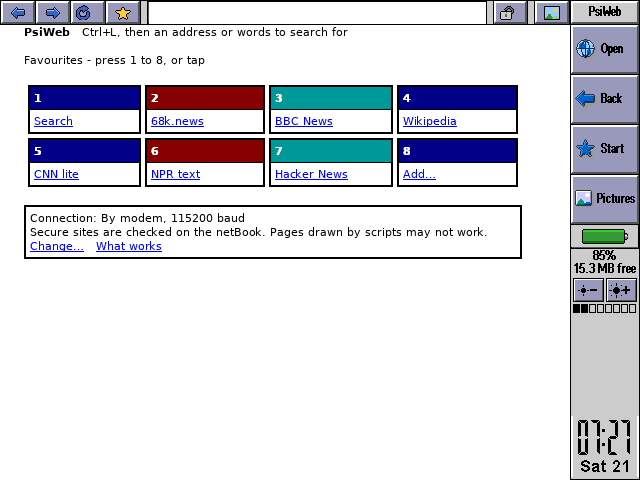

The netBook before (`before-netbook-start.png`, `before-netbook-about.png`) and after (`netbook-start.png`, `netbook-tools.png`, `netbook-help.png`, `netbook-credits.png`), the Series 5mx (`5mx-start.png`, `5mx-about.png`) and the icon at its three sizes (`icon.png`) are in [docs/img/2026-11-21-polish](docs/img/2026-11-21-polish/).

## What's new in 0.98

- **The start page's Add... and What works do what they say.** Add... (or its number key) asks for a name and an address and adds them as a favourite, the next tile, and What works opens Help at "What works and what does not".
- **PsiWeb's own links stay its own.** The links that open Set up PsiWeb, Test the connection, Help and Organise favourites work only on PsiWeb's own pages (the start page and "Page not opened"); a web page cannot open them with a link or a redirect.
- **A clock that is not set is named.** On a Psion whose clock has been reset, a secure page says "The Psion's clock is not set, so no site's certificate can be checked - set the date first", instead of calling the site untrusted.
- **Reload in Lighter, Reader or Text only** shows the page as it is now, not the text it had before.
- **Pictures a page shows wider than they are** are drawn across their whole width.
- **A '<' inside an attribute** (a title, say) is no longer read as a tag, so text on a site cannot add a Refresh line or a form.
- **Cookies across a sleep.** When the engine sleeps, it keeps every cookie it holds, the ones that last only until PsiWeb closes too, so you stay signed in to sites. They wait in PsiWeb's Sleep folder only until PsiWeb comes back, which reads them once and deletes the file at once; if PsiWeb is closed or the Psion restarts first, the file is deleted the next time PsiWeb starts. Coda's backups leave it out.
- **Long favourites.** A favourite with a long address opens the right page from the start page.

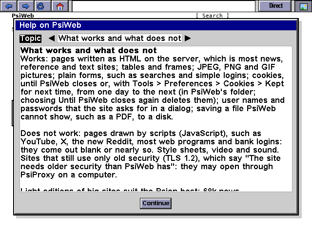

## What's new in 0.97

- **Free memory can put PsiWeb to sleep.** On a Psion with a memory watcher (Coda's PsiHub on the netBook), choosing to put PsiWeb to sleep in its Free memory dialog now ends the engine at once, behind another program, and gives its memory back; the page, Back and Forward and the cookies are kept, and PsiWeb opens again on the same page when you come back to it. If it can't sleep just then, it says why ("a page is still opening", "a download is in progress", "a form on the page would be lost"), and the dialog shows it.
- **Short of memory, PsiWeb helps.** When the watcher says memory is short, PsiWeb drops its caches at once, and when it is very short and PsiWeb is behind another program, the engine sleeps if nothing would be lost.

## What's new in 0.96

- **A route changed in another program is used at once.** Coming back to PsiWeb, it reads the shared connection settings again, so the next page goes by the route PsiMail, PsiTerm or Connection settings chose, without restarting the engine.
- **Quieter.** While the engine sleeps, PsiWeb no longer wakes the Psion every 2 seconds. History.dat is written at most once a minute, when PsiWeb goes behind another program and at Close, not again for every page.
- **The log stays small.** PsiWeb.log is at most 128 KB (it then becomes PsiWeb.old and starts again), and the part of an address after "?" is left out of it.
- **Messages say what went wrong in words**, not as a number. With PsiWeb on the card and the card out, it says "PsiWeb is on the Coda card - put the card in", not to reinstall it.
- **Wording.** The toolbar's Go to is now Address, like File > Open address. View > Show > Bright screen says "Bright screen on" and "off". Organise favourites > Delete asks first, as Clear history does. On the netBook the favourites and history lists are as tall as its own programs' lists.

0.95 kept the preferences, the favourites and the update choice on the card, in \System\Data\Kept\, and put them back if the internal memory is cleared.

## What's new in 0.94

- **Cut, Copy and Paste.** A new Edit menu, with Ctrl+X, Ctrl+C and Ctrl+V and the Clipboard icon beside the screen: while an address is typed in (Ctrl+L), they work on it as in any EPOC text box, and Ctrl+A chooses all of it. Paste with no address being typed puts the clipboard's text into the box on the page that has the cursor (its first line, up to 60 characters), or else into the address, ready for Enter. *Edit > Copy page address* puts the address of the page showing on the clipboard for another program.
- **The engine sleeps only when memory is short.** After ten minutes behind another program, the engine is now ended only if the Psion has under 3 MB free; with plenty free, coming back to PsiWeb no longer reads the engine from the card again and fetches the page again for nothing. (The half-minute trim behind is as before.)
- **Preferences no longer always restart the engine.** The home page, the search page, the page style and keeping cookies take effect at once; the engine starts again, losing what was typed into a form, only when *Text* or *Pictures* changed. Connection settings restart it only when the route changed.
- **Messages say what is wrong.** A message that named *Tools > Restart browser engine* now gives its real place, *Tools > Log > Restart browser engine*. An engine that cannot start says when memory is short or the card is not ready, rather than always to reinstall PsiWeb. When the Psion itself is short of memory, a page says "Not enough memory - only part of the page is shown" (or "not all the pictures are shown") instead of "Page too big". A long reason on the page goes on two lines.
- **The start page is built safely.** Eight favourites with very long addresses could overrun the start page's buffer; what does not fit is now left out.

## What's new in 0.93

- **Stop during an https page no longer hangs PsiWeb.** Stop while a page was coming over PsiWeb's own secure connection left the browser engine reading for ever: nothing on the screen changed and no key did anything until PsiWeb was closed. Now the read ends at once, the connection is closed and the page says Stopped. A read that fails for another reason (a damaged record) ends the connection the same way, as a connection error, instead of going round.
- **A PsiWeb started again no longer takes over the last one's engine.** When PsiWeb crashed or was closed from the task list, its browser engine ran on for up to a minute. A PsiWeb started in that minute cleared the shared memory under it, and the old engine then carried on for good beside the new one, holding the serial port and its connection. The new PsiWeb now asks the old engine to stop, gives it up to 4 seconds to hang up, ends it if it has not, and starts a fresh one.
- **A key or a tap while an https page is coming no longer ends it.** Every key and tap wakes the browser engine, and PsiWeb's own TLS took that wake as the end of the connection: the page said *Page not opened*. It now waits on through it for the rest of the page (psion-core 1d259b2).

## What's new in 0.92

Memory. On a machine with no swap, PsiWeb held about 5 MB for as long as it was open, in front or not (measured on a netBook: the engine's code 2 MB, its heap and stack 1.9 MB, the screen it shares with PsiWeb 0.35 MB, PsiWeb itself 0.3 MB and its pictures in the bitmap server), and never gave any of it back.

- **Memory comes back after each page.** The engine's heap gives its free end back to the Psion when a page has finished loading (`User::Heap().Compress()`), so the peak of a big page is no longer kept until PsiWeb closes.
- **Behind another program, PsiWeb gets smaller.** After half a minute behind, the engine drops its caches and the pictures away from the view and gives the freed memory back. They are read again when PsiWeb comes forward. (On a page of text alone this is little: 12 to 20 KB in the emulator.)
- **After ten minutes behind, the engine sleeps.** If nothing would be lost (no page loading, no file being saved, no question or list open, no form filled in, no page that came from a form), the engine is ended and its code and heap, go back to the Psion (in the netBook emulator, a long page: 4.4 MB of heap and data, and on a machine that runs PsiWeb from a disk its 2 MB of code as well). PsiWeb's window stays as it was. When PsiWeb comes forward, or is sent an address, the engine starts again ("Opening the page again...") on the same page at the same place, with its Back and Forward lists and its cookies, the session's too (in Sleep\cookies.txt only until the engine wakes, which deletes it at once; one never woken from is deleted at the next start). Not kept: a password given for a site's own sign-in box (it asks again), and the place down each earlier page. If another address is opened instead, the page of before is one step Back.
- **Pictures no longer crawl when the Psion is short of memory.** With under about 1.75 MB free on the whole machine, every picture's every allocation threw away the font, layout and picture caches and built them again, only to refuse the picture: a page with pictures could sit on "Opening" for minutes. Dropping the caches is now tried again at most every two seconds while it does not help. The pictures that do not fit are still shown as boxes with "Page too big - not all the pictures are shown".
- **The scroll bar goes cleanly, and PsiWeb is no longer closed for it.** When the bar went, the page's window, a backed-up one, was asked for a redraw (`Invalidate`) that such a window does not have. In the netBook emulator 0.91 is left with the old scroll bar drawn beside a page that fits the screen (a long page, then a short one: `docs/img/2026-11-18-sleep/091-long-to-short.png`; its Stop button was showing before the short page was asked for, which was not looked into), and with the engine stopped under a long page the window server closed PsiWeb (WSERV 1). The strip the bar leaves is now drawn directly: the same two pages in 0.92 show the short page with no bar (`092-long-to-short.png`).
- Tested in the netBook emulator (a test build with the waits at 10 and 25 seconds): a long page, PsiWeb sent behind Word, trimmed, slept (engine gone, 4.4 MB back), brought forward ("Opening the page again...", the page back), Ctrl+B to the page before and Ctrl+F forward again (`docs/img/2026-11-18-sleep/`). Not tested: cookies and the place down the page across a sleep (the test pages were files), a real netBook or 5mx.

## What's new in 0.91

- **Set up PsiWeb sets *Modem provides TLS* for the Atom.** PsiWeb's own setup assistant now sets the shared connection setting *Modem provides TLS* from the way online chosen, exactly as PsiMail's assistant does: on for the Atom modem, off for another modem. Someone who uses only PsiWeb, direct through the Atom, no longer gets PsiWeb's TLS wrapped inside the Atom's (the site answered "400 Bad Request"). Only that existing setting is set; nothing else in the connection settings changed, and Cancel still changes nothing. In the 5mx emulator (`net.py atomtls`), OK on the assistant's standard choices for a 5mx (the Atom modem, Direct) is now enough for https://example.com/ to come through the Atom's own TLS.

## What's new in 0.90

- **Direct https through the Atom works.** The PsiConnect Atom, with its standard `AT$TLS=1`, makes the secure connection itself when it is dialled on port 443, and hands the Psion the page in plain. PsiWeb did its own TLS on top of that, so every direct `https://` page through the Atom failed. PsiWeb now honours the shared connection setting *Modem provides TLS* (PsiLink.ini, set in PsiMail's Connection settings and by PsiMail's setup assistant for the Atom), as PsiMail does: on the modem route with it on, an `https://` address on port 443 goes to the Atom in plain HTTP and the Atom does the TLS. The 36 MHz Psion then does no cryptography at all: in the ARM harness example.com took 2.4 million instructions (about 0.2 s on a 5mx) where PsiWeb's own TLS takes 153 million (about 10 s). Nothing in the connection settings changed. On the Psion Internet route, through a web helper, or with the setting off, PsiWeb does its own TLS as before, as it does for an `https://` address with a port of its own.
- **Who checked the site, said truthfully.** The Atom checks the site's certificate against the Mozilla roots in its firmware and the name in it (unless its `AT$TLSV` is 0; Atom firmware 2.9 also mends a fault that left later calls unchecked after one call with `AT$TLSV=0`). On such a page the padlock is shut and the route light says *Atom* instead of *Direct*, and Page information says "Direct, checked by the Atom modem" rather than "secure, checked by this Psion". When the Atom cannot make the secure connection (an untrusted certificate, another name, a site that is down, no WiFi) it only says NO CARRIER: the *Page not opened* page then says the Atom modem could not make a secure connection, and that the Atom's log says which. Help > Ways to connect says the same.
- **example.com and other Cloudflare sites on SSL.com's chain** were refused ("Certificate not trusted"). Their chain now ends in SSL.com TLS ECC Root CA 2022, which psion-core's built-in roots did not have (the cross-signed copy they also send leads to AAA Certificate Services, which Mozilla's list no longer has). SSL.com TLS ECC Root CA 2022 and its RSA sibling were added from Mozilla's list (psion-core 4ea0c67, about 1 KB). PsiMail and PsiSync share the roots and get them with their next build.
- Not changed in 0.90: PsiWeb's own setup assistant still left *Modem provides TLS* as it found it; 0.91 sets it (above).

## What's new in 0.89

- **Test the connection fetches a page.** The *Test the connection* link on a *Page not opened* page now goes on, once the modem answers or the network is up, to fetch a small file from GitHub (the one PsiWeb's updates are checked with) the way pages come: direct, with PsiWeb's own TLS and certificate check, or through the Atom modem helper or PsiProxy. The window says in a line whether it came and how long it took ("A page came through the Atom from GitHub in 4.0 s - the web works"), or why not ("No page came direct from GitHub" and the likely cause, in the words of the *Page not opened* page). When the serial port was held by PsiWeb's own connection, which the page has just come through, the window says so instead of "the serial port is in use". Esc stops it.
- **The busy message says the way.** While a page opens, the message at the bottom left names the page and the route, with how much has come: "Opening bbc.co.uk through PsiProxy - 64 KB...", "Opening 68k.news direct...", then "Fetching pictures through the Atom - 12 of 30...". The connection's routine notes for each connection ("Connecting to 10.0.0.5:8080...", "Request sent...") no longer replace it; dialling, looking up a name and the modem still say what they do.
- **No scroll bar on a page that fits.** The bar beside the page shows only while the page is longer than the screen (the start page, short pages and *Page not opened* have none). Its room stays the page's white margin, so a page lays out the same with or without it, and showing the bar never moves the text.
- **Zoom is remembered per machine.** PsiWeb.ini keeps the 5mx's size and the netBook's apart, so a settings file copied from one machine to the other keeps each machine's own zoom (a file from before 0.89 counts as the machine's that wrote it).
- **Kept cookies now survive closing PsiWeb.** Up to 0.88, Preferences > Cookies > *Kept for next time* did not keep them, for two reasons found by the new tests: closing PsiWeb wrote the cookies after Links had freed them, so an empty file went over the kept one; and Links replaced its cookies file by renaming a new one over it, which EPOC does not do when the file is there, so the file kept whatever the first page done had left in it (usually nothing: the start page). The cookies are now saved when a page is done and when the engine is asked to close, and the old file is deleted before the new one takes its name. Tested end to end with a small server that sets and reads cookies, in the ARM harness (kept, and *Until PsiWeb closes*, across two sessions) and in the 5mx emulator (closed and opened again from the Extras bar).
- **Keys and the silkscreen on the netBook, checked.** psion-netbook's `tools/keytest` (Coda's standing rule) run on a Coda image with this PsiWeb, side by side with Psion's own image running Opera, the netBook's browser: the five Command icons work in PsiWeb as in Opera (Menu opens the menus, Clipboard offers Cut, Copy and Paste, Infrared offers Send and Receive, Zoom in and Zoom out go round the sizes, 110%, 125%, 110%); in the address, typing, Shift with the arrows, Ctrl+C, Ctrl+V and Ctrl+X work; Ctrl+K, Ctrl+T, Shift+Ctrl+T, Ctrl+M, Shift+Ctrl+M, Ctrl+B, Ctrl+U, Ctrl+O, Ctrl+L, Ctrl+H, Ctrl+Menu (PsiHub) and Ctrl+E do what PsiWeb's menus say. Differences from Psion's programs, by design: Ctrl+F is Forward and Ctrl+I Show pictures (a browser's keys, as since 0.62); Ctrl+P, Shift+Ctrl+P, Ctrl+S, Shift+Ctrl+S, Ctrl+N, Ctrl+A, Ctrl+D, Ctrl+W, Ctrl+Q, Ctrl+J, Ctrl+G and Ctrl+Y do nothing, as PsiWeb has no printing, saving of pages, new files, selection, find or redo; Ctrl+Z in the address leaves it (the address shows the page again) rather than undoing, as the address has no undo. Ctrl+E during a dial closes PsiWeb once the dial has been stopped, a few seconds later.
- **Several connections at once (the plan's D11): measured, not done in this version.** The ARM harness can now play a recorded page back with a round trip before every answer (`run_links.py --replay DIR --latency MS --mips N`), which is what one connection pays one answer after another. On the netBook's speed (75 MIPS on the harness's clock), with pictures: the Guardian's front page (1.8 MB, 144 answers over 4 connections) takes 9.5 s with no round trip, 16.3 s at 50 ms and 32.2 s at 150 ms; GitHub's page for PsiWeb (15 answers) 5.8 s, 5.4 s and 7.3 s (half a second either way is the harness's own spread). Three connections at once could save up to two thirds of the waiting, about 5 s of 16 at 50 ms on the Guardian, nothing worth having on light pages, and nothing on the 5mx's modem, which has one line. Memory is not the obstacle (about 70 KB a TLS connection, so three fit on both machines); the work is: the suite's TLS 1.3 (`core/ssh/tls13.c`) keeps its connection in static memory, and psiglue has one socket, both shared with PsiMail and PsiTerm. Giving each connection its own state there is a change to psion-core of its own, to be done and tested with PsiMail, not inside a PsiWeb release.
- A pixel column right of the page (the engine's page is an even number of pixels wide; the room beside it may be one more) is drawn white, where it could show part of an earlier, wider frame after a bar was shown or hidden.

## What's new in 0.88

- **A fourth way: a full browser elsewhere.** File > Open in full browser hands the page showing (or the one that would not open) to PsiTerm, which connects to one of its saved servers, by name, and runs a browser there with the address: [Carbonyl](https://github.com/fathyb/carbonyl), Chrome drawn in a terminal, so pages drawn by scripts, logins and all open there, or w3m (offered on the 5mx, whose screen suits it). The server's own login is used; the address goes to its shell as one quoted word. Needs PsiTerm 1.15. Install Carbonyl on any Linux or Mac computer with Node: `npm install --global carbonyl` (or `docker run --rm -ti fathyb/carbonyl URL`); w3m with `apt install w3m` or `brew install w3m`. Help > Ways to connect says the same.
- **NetSurf "Full layout" trial on the netBook: stopped at its gate.** The plan allowed a NetSurf engine for the netBook only if BBC and the Guardian laid out with their own style sheets in under 20 MB of heap and under 10 s at 150 MIPS (1,500 million instructions). In the old NetSurf harness (`emu/run_psiweb.py`, the engine as it was at 0.61, rebuilt with today's core) BBC took 1,995 million instructions and peaked at 20.0 MB, the harness's limit, and showed only its first heading; the Guardian was still fetching style sheets and pictures after seven minutes. Both miss, so NetSurf stays out, as the plan says (the build rule for its colour code, broken since 0.80, is mended in `Makefile`).
- Not done: several connections at once on the network card (the plan's D11); measured in 0.89, see there.

## What's new in 0.87

- **Cookies kept for next time**, if you ask: Tools > Preferences > Cookies > *Kept for next time* keeps a site's cookies (what keeps you logged in) in PsiWeb's folder from one day to the next; *Until PsiWeb closes*, the standard, is as before, and choosing it again deletes the kept ones. Only cookies a site gives a date are kept, as other browsers do.
- **A lighter edition offered.** On CNN, NPR, Reddit, English Wikipedia and DuckDuckGo, a line at the top of the page offers the site's own light edition (lite.cnn.com, text.npr.org, old.reddit.com, en.m.wikipedia.org, html.duckduckgo.com): offered, never forced. A page drawn by scripts says so in Lighter, Reader and Text only, with the reader service (FrogFind).
- **Saving a file**: as big as the disk has room for, less 256 KB for the Psion, where it was at most 4 MB.
- Not in this version: WebP pictures (the plan's D9). 0.86 asks sites for JPEG, PNG and GIF instead; whether boxes for WebP pictures are still common has to be seen on a real netBook before 150 to 250 KB of decoder is worth it.

## What's new in 0.86

- **A start page with a speed dial.** PsiWeb opens on its own start page (Go > Start page, or the Start button): a search box, eight tiles that are your first eight favourites (a new PsiWeb gets Search, 68k.news, BBC News, Wikipedia, CNN lite, NPR text and Hacker News; the eighth is Add..., which asks for a name and an address, until there are eight), the pages you saw last, and the way you are connected with *Change...* and *What works*. Keys 1 to 8 open the tiles while it shows (not while the search box has the cursor), or tap them. On the netBook the tiles are in EPOC's own colours with a Recent list; on the 5mx they are greys, with a line for each.
- **Page styles on the Psion.** View > Page style: *Full* (the page as it comes, the standard), *Lighter* (scripts, styles, hidden parts and tracking pictures out), *Reader* (menus, sidebars, banners and link lists out too: an article first) and *Text only*. Shift+Ctrl+R goes round them for the page showing, at once. They use the PsiConnect Atom's own page simplifier, built into the engine. A line at the top of a lightened page says when its pictures were left out (*Show pictures*), when it was cut at the machine's limit (*Show the rest*: 512 KB on the 5mx, 2 MB on the netBook) and when it is drawn by scripts (*Try the reader service*, FrogFind).
- **The route light.** On the toolband: *Direct*, *Atom* or *PsiProxy*, a padlock for a secure page checked on the way, and L, R or T for the page style. A tap opens Page information, which now says how the page came, whether it is secure and who checked it, its style, its size (and how much was kept) and the pictures left out.
- **AES-128-GCM** as a second TLS 1.3 cipher (psion-core's `ssh/aesgcm.c`), for servers that offer AES only: eBay, the one site of 50 that PsiWeb could not reach direct, now connects. ChaCha20-Poly1305 stays first.
- **Bars without a restart.** Showing or hiding the toolbar (Ctrl+T) or the toolband (Shift+Ctrl+T) lays the page out again at the new width, on the same page and place; the engine no longer restarts (no "Restarting the browser engine..." and no blank page).
- **The toolbar**: Address (File > Open address), Back, Start, Pictures. **The toolband**: Back, Forward, Reload (Stop while a page loads, one button), Start, the address, the route light, Pictures. The progress bar runs along the bottom of the address while a page loads, and is gone when idle (no empty gap beside the address).
- **Address completion.** As you type in the toolband's address, the first favourite or recent page that begins the same way is offered, chosen, so typing on replaces it and Enter takes it.
- **Help on the netBook** uses a dialog the size of the netBook's own large dialogs, its text taking the room; a new topic, *Page styles*.
- Pictures are asked for as JPEG, PNG or GIF (the Accept header no longer offers WebP); the netBook's engine may grow to 20 MB (the 5mx stays at 10 MB).

Measured (ARM harness, the same pages served locally so only the Psion's own work counts; millions of instructions, Full / Lighter / Reader): BBC home 43 / 54 / 48, BBC News 56 / 64 / 61, the Guardian 79 / 108 / 104, GitHub 33 / 45 / 36, Wikipedia 21 / 27 / 22, Hacker News 31 / 26 / 27. Links already parses a whole page quickly, so making it lighter first costs about as much as it saves: the styles are for reading (Reader puts an article first), not for speed, and Full stays the standard. Pages in Full draw exactly as in 0.83 (screenshots compared pixel for pixel on both machines).

## What's new in 0.85

- **Set up PsiWeb.** The first time PsiWeb starts on a Psion with no settings from any program of the suite, one dialog asks how the Psion goes online (a network card or dial-up, the Atom modem, another WiFi modem), how pages come (Direct, the Atom modem helper, PsiProxy on a computer) and about pictures and search. It is always on Tools > Set up PsiWeb... It writes the same connection settings as before (shared with PsiTerm and PsiMail): nothing new in them, and Cancel changes nothing. A netBook is offered the network card first.
- **The routes are named.** *Direct*, *Atom modem helper* and *PsiProxy on a computer* everywhere: setup, Help, About, Page information. The word "proxy" is gone from what you read. In Connection settings the link is now *Network card or dial-up (Psion TCP/IP)* (it was *Psion TCP/IP (dial-up)*), the same in PsiTerm and PsiMail, and *Use proxy* is the *Web helper*. The settings themselves did not change.
- **Pages that do not open say why.** In place of a two-second infoprint, a *Page not opened* page: what could not be reached, the likely cause in plain words (the serial port in use, no connection, the name not found, refused, no answer, older security, a certificate not trusted or the Psion's date), and *Try again*, *Test the connection* and *Set up PsiWeb* as links. The address that did not open stays in the address box to correct. The route is on the page.
- **Search works.** Words typed for an address (Ctrl+L, Ctrl+O) go to DuckDuckGo's page without scripts, or FrogFind (Tools > Preferences > Search with). Before, "Or words to search for" gave "No such file or directory".
- **Pictures on every page on a netBook** with a network card going direct, as standard for a new PsiWeb; still only when asked over a modem.
- **Menus regrouped.** Home page moves to Go, with a new Start page; View > Show holds Toolbar, Toolband and *Bright screen* (Reading mode renamed, now Shift+Ctrl+B); Tools > Log holds Keep a log, Send log to server and Restart browser engine; Tools > Set up PsiWeb... is new.
- **No internal names** (`about:welcome`) in the address box or Open address.
- About says *for the Psion Series 5mx, netBook and Series 7* and the route in plain words; Help has *Ways to connect* and *What works and what does not*, with a paragraph for the machine it runs on.

## What's new in 0.84

- HTTPS checks certificates. Without a proxy, a site whose certificate cannot be trusted (not from a known authority, out of date, for another name) is not loaded: *Certificate not trusted - host*. RSA and ECDSA (P-256 and P-384) certificates, so every site on the welcome page loads direct. See *Certificates* below.
- PsiWeb's own updates from GitHub are checked the same way, as well as by their signature.

## What's new in 0.80

Since 0.77, the last signed release.

- Runs on the netBook and Series 7 in colour: pages and pictures in EPOC's 256 colours, on the whole 640x480 screen, with the toolband in place of the toolbar. The same PsiWeb.sis still gives 16 greys on the 5mx, with no extra memory used.
- A toolband along the top with Back, Forward, Reload, Stop, Home, the address, a progress bar and Pictures. View > Show toolband (Shift+Ctrl+T). Shown at first on the netBook.
- Tap the address, or press Ctrl+L, and type an address or words to search for.
- The progress bar fills as the page loads, then as its pictures do.
- Send log goes through the Atom modem's own proxy to PsiProxy, and only says "Log sent" if PsiProxy got it.
- The program icon is in colour on the netBook.
- Help and the welcome page cover the toolband and the netBook.

## Screenshots

PsiWeb 0.89 to 0.85 (the first rows) and 0.80 on the netBook (colour, 640x480) and the Series 5mx (16 greys, 640x240). Taken in emulators; pages and the netBook's *Page not opened* in the ARM harness, as the netBook emulator has no network. Tap or click one to see it full size.

<table>
<tr><th>netBook</th><th>Series 5mx</th></tr>
<tr><td><b>The start page with no scroll bar, as it fits (0.89)</b></td><td><b>The busy message says the way (0.89)</b></td></tr>
<tr>
<td><a href="docs/img/netbook-psiweb-start.png">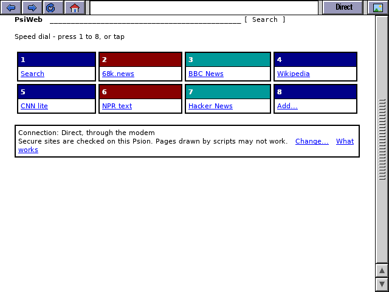</a></td>
<td><a href="docs/img/5mx-psiweb-busy-route.png">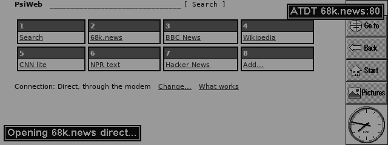</a></td>
</tr>
<tr><td><b>Zoom, kept for this machine only (0.89)</b></td><td><b>Test the connection, with a page through the Atom (0.89)</b></td></tr>
<tr>
<td><a href="docs/img/netbook-psiweb-zoom.png">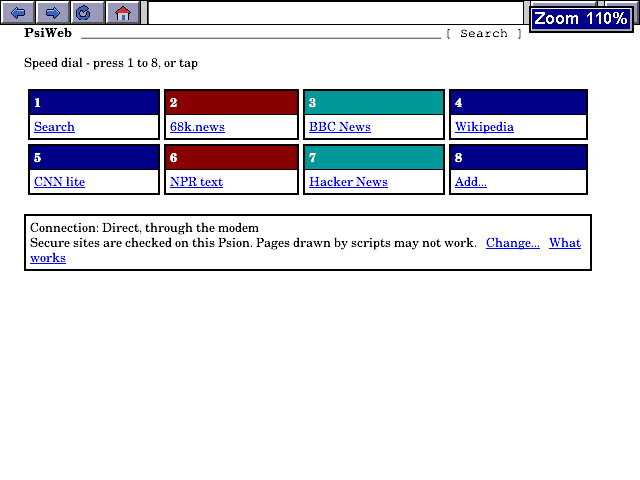</a></td>
<td><a href="docs/img/5mx-psiweb-test-connection.png">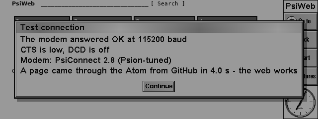</a></td>
</tr>
<tr><td></td><td><b>Kept cookies after PsiWeb was closed and opened again (0.89)</b></td></tr>
<tr>
<td></td>
<td><a href="docs/img/5mx-psiweb-cookies-kept.png">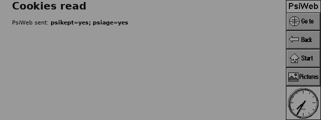</a></td>
</tr>
<tr><td><b>Open in full browser (0.88)</b></td><td><b>...handed to PsiTerm (1.15)</b></td></tr>
<tr>
<td><a href="docs/img/5mx-psiweb-full-browser.png">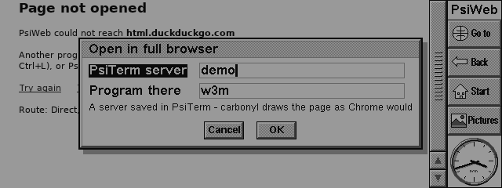</a></td>
<td><a href="docs/img/5mx-psiweb-full-browser-psiterm.png">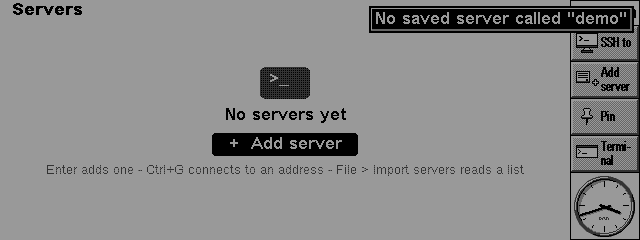</a></td>
</tr>
<tr><td><b>A lighter edition offered, Wikipedia (0.87)</b></td><td><b>Preferences, with Cookies (0.87)</b></td></tr>
<tr>
<td><a href="docs/img/netbook-psiweb-lighter-edition.png">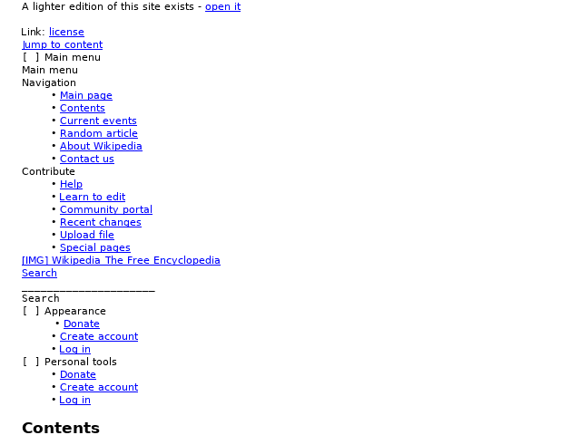</a></td>
<td><a href="docs/img/5mx-psiweb-preferences.png">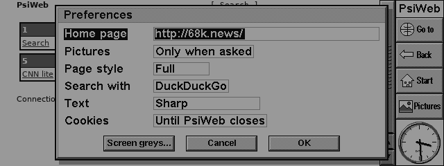</a></td>
</tr>
<tr><td><b>A page drawn by scripts says so (0.87)</b></td><td></td></tr>
<tr>
<td><a href="docs/img/netbook-psiweb-drawn-by-scripts.png">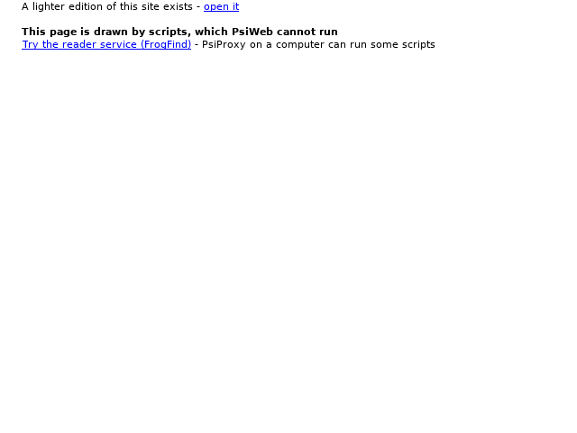</a></td>
<td></td>
</tr>
<tr><td colspan="2"><b>The start page and its speed dial (0.86)</b></td></tr>
<tr>
<td><a href="docs/img/netbook-psiweb-start.png"></a></td>
<td><a href="docs/img/5mx-psiweb-start.png">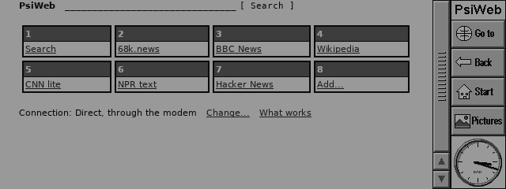</a></td>
</tr>
<tr><td colspan="2"><b>BBC News in Full (0.86)</b></td></tr>
<tr>
<td><a href="docs/img/netbook-psiweb-bbc-full.png">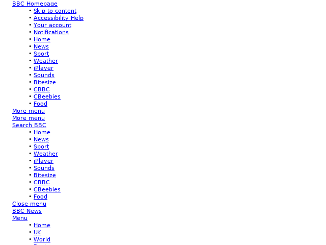</a></td>
<td><a href="docs/img/5mx-psiweb-bbc-full.png">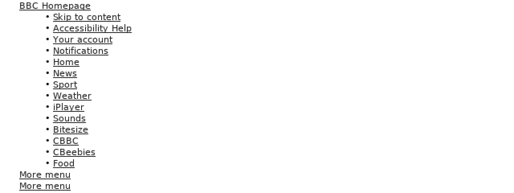</a></td>
</tr>
<tr><td colspan="2"><b>...and in Reader: the article first (0.86)</b></td></tr>
<tr>
<td><a href="docs/img/netbook-psiweb-bbc-reader.png"></a></td>
<td><a href="docs/img/5mx-psiweb-bbc-reader.png"></a></td>
</tr>
<tr><td><b>Help, the size of the netBook's own large dialogs (0.86)</b></td><td><b>View > Page style (0.86)</b></td></tr>
<tr>
<td><a href="docs/img/netbook-psiweb-help.png">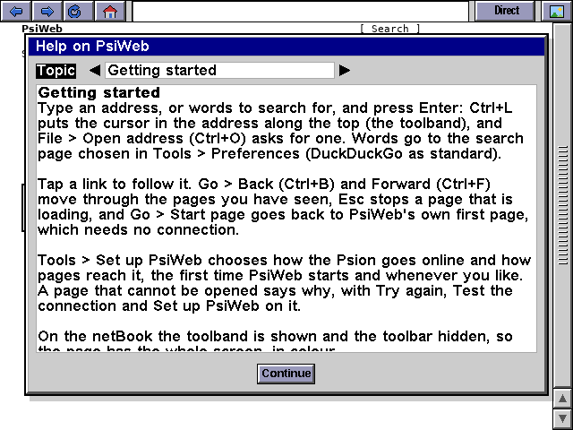</a></td>
<td><a href="docs/img/5mx-psiweb-page-style.png">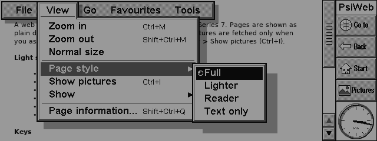</a></td>
</tr>
<tr><td><b>The toolband's address offering 68k.news (0.86)</b></td><td><b>Page information (0.86)</b></td></tr>
<tr>
<td><a href="docs/img/5mx-psiweb-address-completion.png">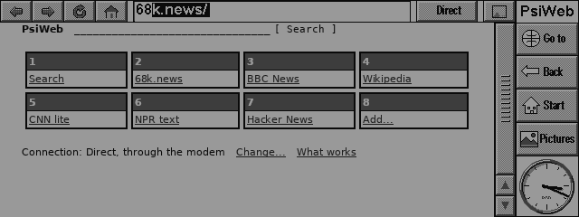</a></td>
<td><a href="docs/img/5mx-psiweb-page-info.png">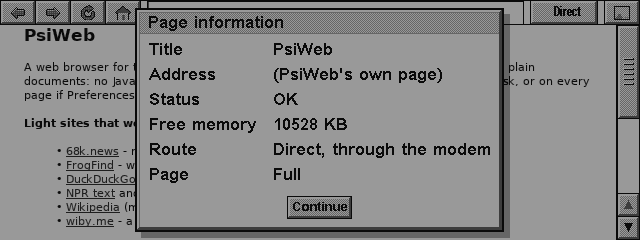</a></td>
</tr>
<tr><td colspan="2"><b>Set up PsiWeb: how the Psion goes online</b></td></tr>
<tr>
<td><a href="docs/img/netbook-psiweb-setup.png">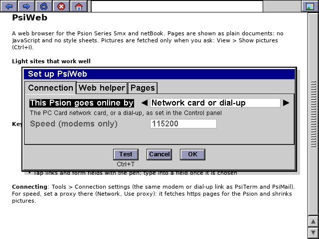</a></td>
<td><a href="docs/img/5mx-psiweb-setup.png">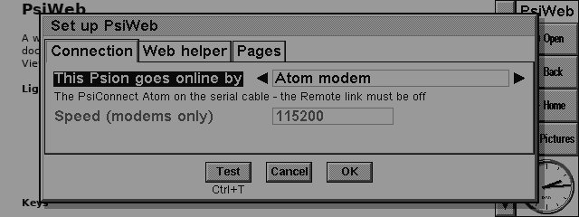</a></td>
</tr>
<tr><td colspan="2"><b>Set up PsiWeb: how pages come</b></td></tr>
<tr>
<td><a href="docs/img/netbook-psiweb-setup-helper.png">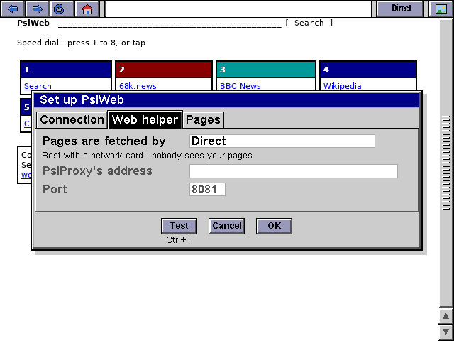</a></td>
<td><a href="docs/img/5mx-psiweb-setup-helper.png">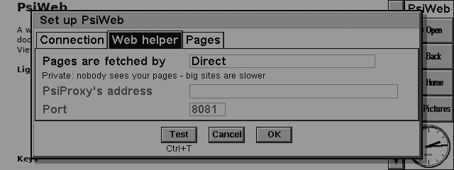</a></td>
</tr>
<tr><td colspan="2"><b>Set up PsiWeb: pictures and search</b></td></tr>
<tr>
<td><a href="docs/img/netbook-psiweb-setup-pages.png">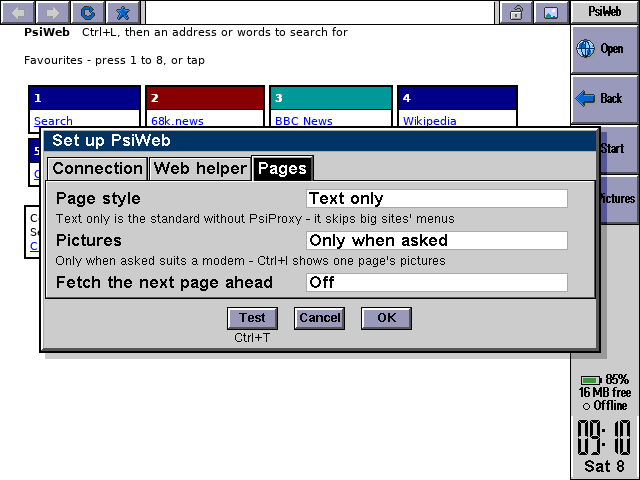</a></td>
<td><a href="docs/img/5mx-psiweb-setup-pages.png">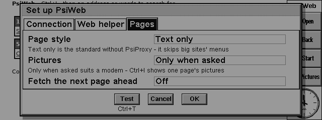</a></td>
</tr>
<tr><td colspan="2"><b>A page that cannot be opened says why</b></td></tr>
<tr>
<td><a href="docs/img/netbook-psiweb-not-opened.png">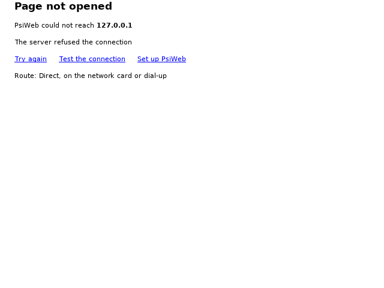</a></td>
<td><a href="docs/img/5mx-psiweb-not-opened.png">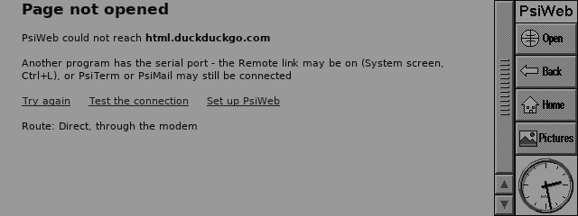</a></td>
</tr>
<tr><td colspan="2"><b>About, with the route in plain words</b></td></tr>
<tr>
<td><a href="docs/img/netbook-psiweb-about.png">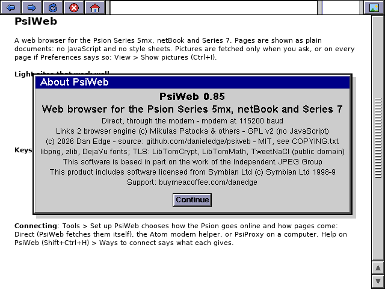</a></td>
<td><a href="docs/img/5mx-psiweb-about.png">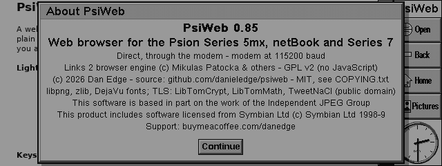</a></td>
</tr>

<tr><td colspan="2"><b>The welcome page, with the toolband</b></td></tr>
<tr>
<td><a href="docs/img/netbook-psiweb-welcome.png">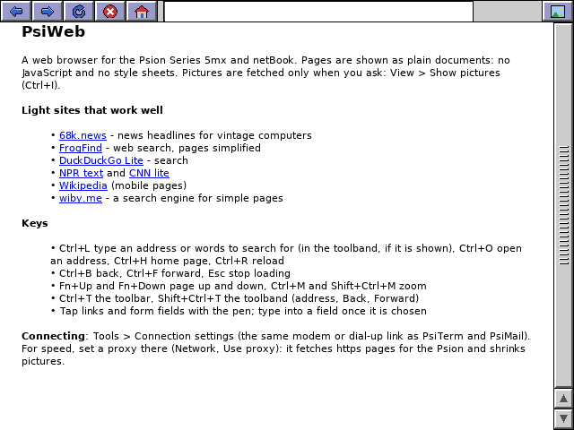</a></td>
<td><a href="docs/img/5mx-psiweb-welcome.png">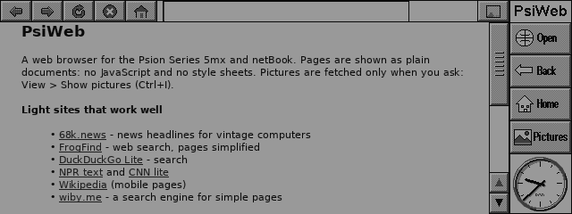</a></td>
</tr>
<tr><td><b>The File menu</b></td><td><b>Typing an address in the toolband</b></td></tr>
<tr>
<td><a href="docs/img/netbook-psiweb-menu.png">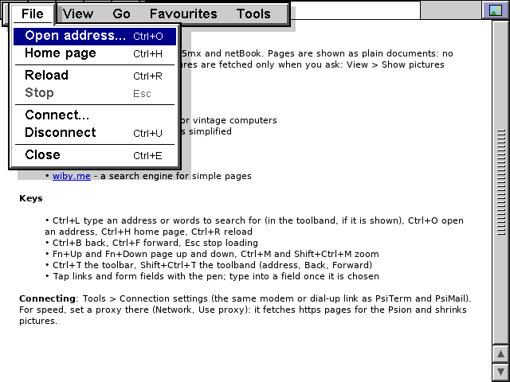</a></td>
<td><a href="docs/img/5mx-psiweb-address.png">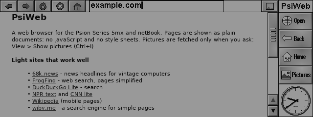</a></td>
</tr>
</table>

## Using it

Install `dist/PsiWeb.sis` (to D: if you have a CF card). PsiWeb is on the Extras bar.

| Key | |
|---|---|
| Ctrl+L | type an address, or words to search for, in the toolband (the Open address dialog when the toolband is hidden) |
| Ctrl+O | open an address, or type words to search for (with a list of recent pages) |
| Ctrl+B / Ctrl+F | back / forward |
| Esc | stop loading (or saving a file) |
| Ctrl+R, Ctrl+H | reload, home page |
| Up / Down, Fn+Up / Fn+Down | scroll a line / a screen |
| Left / Right | scroll a wide page sideways |
| Ctrl+M, Shift+Ctrl+M | zoom in / out (they cycle round the sizes); the Zoom in and Zoom out icons beside the screen do the same |
| Ctrl+T | show or hide the toolbar (the page takes its room) |
| Ctrl+I | show the pictures of this page, or take them away (as the Pictures button) |
| Shift+Ctrl+D | add this page to Favourites |
| Shift+Ctrl+Q | page information (title, address, status, free memory, the route) |
| Shift+Ctrl+B | Bright screen (more contrast, the backlight kept on) |
| Shift+Ctrl+R | the next page style (Full, Lighter, Reader, Text only) |
| 1 to 8 | on the start page, open a tile |
| Ctrl+U | disconnect (hang up and free the serial port) |
| Ctrl+K | preferences: home page, pictures, page style, search, text, cookies |
| Shift+Ctrl+H | help on PsiWeb |
| Shift+Ctrl+A | about PsiWeb |
| pen | tap links, buttons and form fields; the scroll bar beside the page (EIKON's) scrolls it |

The toolbar (Open, Back, Home, Pictures - pressed in while the page's pictures show) and the menus (File, View, Go, Favourites, Tools) follow the EIKON style guide, as PsiTerm's and PsiMail's do. Links' own menus, dialogs and bars are never shown: everything goes through PsiWeb.app.

**Favourites and History.** The menu bar is File, View, Go, Favourites, Tools. *Favourites > Add to favourites...* (Shift+Ctrl+D) saves the page showing (name from its title, editable); the first five are listed on the menu, *More favourites...* lists the rest, and *Organise favourites...* edits or deletes them (up to 40). *Go > History* lists the last five pages, newest first, with *Full history...* (50) and *Clear history*; a page is logged when it has loaded, a repeat moves to the top, and `about:` pages are skipped. *Open address* has a *Recent* line with the last twelve. They are kept in `C:\System\Apps\PsiWeb\Favourites.dat` and `History.dat` (not in PsiWeb.ini).

**Passwords.** A page (or the web helper) that asks for a user name and password brings up PsiWeb's *User name and password* dialog. HTTP Basic and Digest (MD5 and SHA-256) are both understood. PsiWeb keeps the answer until it closes.

**Files PsiWeb cannot show** (a PDF, a ZIP, a Word file): PsiWeb says what the file is and how big, and asks "Save it to a file?". Yes opens the standard Save as dialog (Documents on the Memory disk if there is one). The bottom left then shows how much has come, "Saved" says when it is done, and Esc stops it. A file bigger than the disk's free room (less 256 KB) is not saved, and a part file is never left behind.

**Tools > Set up PsiWeb**: the first-time setup (see *Ways to connect*), any time.

**Tools > Connection settings**: a modem (`ATDT host:port`, as PsiTerm) or a network card or dial-up (the Psion's own TCP/IP), baud rate and flow control, and the web helper. These are the same settings as PsiTerm and PsiMail use. **Test** (Ctrl+T) tries them before OK. The serial port can be used by one program at a time, so disconnect PsiTerm or PsiMail first (and the Remote link must be off). The [PsiConnect Atom modem firmware](https://github.com/danieledge/psiconnect) is a Wi-Fi modem tuned for the Psion.

**Tools > Preferences**: the home page, pictures, search and text.

### Ways to connect

How the Psion goes online is set once for PsiWeb, PsiMail and PsiTerm: a **network card or dial-up** (the Psion's own TCP/IP, set up in the Control panel: a netBook's PC Card network card, or a dial-up) or a **WiFi modem** on the serial port, such as the [PsiConnect Atom](https://github.com/danieledge/psiconnect). Pages then come one of three ways:

| | **Direct** | **Atom modem helper** | **PsiProxy on a computer** |
|---|---|---|---|
| What you need | Nothing extra | The PsiConnect Atom modem | A computer at home that is switched on, running [PsiProxy](https://github.com/danieledge/psiproxy) |
| In one line | PsiWeb fetches pages itself | The modem fetches pages and makes them lighter | Your computer fetches pages and makes them much lighter |
| Good for | A netBook on a network card; light sites on any Psion | A 5mx anywhere there is WiFi | A 5mx at home; heavy news sites; every kind of picture |
| Speed | netBook: fast. 5mx on a modem: slow on big sites | About three times quicker than direct on a modem | Quickest: pages are a twentieth of the size |
| Secure sites (https) | Checked by the Psion itself; nobody in between | Checked by the modem, which sees the page | Checked by the computer; the page and any password cross your home network unencrypted |
| Pictures | JPEG, PNG, GIF; some newer kinds show as a box | Small ones converted | All kinds, made small |
| Pages drawn by scripts | Do not work | Do not work | Some work, if turned on in PsiProxy |
| Away from home | Works wherever the Psion is online | Works wherever the modem has WiFi | Does not work |
| In Connection settings | Web helper: None - direct | Web helper `psiproxy`, port 8080 | Web helper: the computer's address, port 8081 |

*Set up PsiWeb* writes these for you; no address is built in. Direct uses PsiWeb's own TLS 1.3 client (X25519, ChaCha20-Poly1305, session resumption) and checks each site's certificate, as PsiMail does (see *Certificates*). Which to choose across the suite: [Choosing your setup](https://github.com/danieledge/psion-core/blob/main/docs/SETUP.md).

**Certificates** (0.84). Going direct, PsiWeb checks who it is talking to before it sends anything: the site's certificate chain must reach one of the root certificates built into it (psion-core's `mail/engine/tlsv/roots.h`, 28 roots: Let's Encrypt, Google, DigiCert, Sectigo, GlobalSign, Amazon, Microsoft, Go Daddy, Starfield), every certificate on the way must be in date, the site's own must carry the name in the address, and the site must prove it holds that certificate's key. If any of that fails the page is not loaded and PsiWeb says *Certificate not trusted - host*. There is no way round it from the Psion: no "load anyway", and no list of exceptions. (PsiWeb.log, with Tools > Log > Keep a log ticked, has the reason: a different name, out of date, an authority PsiWeb does not know.)
- RSA keys and ECDSA keys on P-256 and P-384 are checked: between them nearly every site (Let's Encrypt's E and Y certificates, as Wikipedia, Hacker News and FrogFind have; Google's and Cloudflare's; GlobalSign's, as CNN lite has). RSA is offered first, being the cheaper on the Psion. A key of another kind gives *Certificate cannot be checked - host*; a server that will not talk to PsiWeb's TLS at all, *Secure connection refused - host*. Through a web helper, either still loads.
- It costs time. On a 5mx (15 MIPS) one check takes about 0.6 s for RSA-2048, 5 s for RSA-4096, 1.2 s for ECDSA P-256 and 3.6 s for P-384; on the netBook about a fifth of that. A new connection checks two (the site's certificate and its signature): about 1.2 s for an RSA site, 2.3 s for Google or Cloudflare, 4.7 s for a Let's Encrypt ECDSA site. The first time a chain's intermediate certificates are seen they are checked too, then remembered in `C:\System\Apps\PsiWeb\certs.txt`. A resumed connection checks nothing again.
- The Psion's clock must be roughly right (certificates have dates). If it was never set (before 2024), dates are not checked.

With a web helper set, every request goes to it as plain HTTP, `https://` ones too: the helper does the TLS (so the Psion skips a handshake for each site, and can reach sites its own TLS cannot), keeps one connection open for the session (the modem dials once), and slims the page. The Atom modem helper simplifies pages, converts small pictures and gzips the line; tell it where a PsiProxy is (`AT$PU`) and it hands calls to that. PsiProxy on a computer extracts articles, turns home pages into headline lists, converts every kind of picture for the screen, can render script-drawn pages in a headless browser if you turn that on, and receives logs from *Send log to server*. Any HTTP proxy that takes `GET http://...` requests (such as WebOne) also works as a helper, without the slimming.

**Keep a log** (Tools > Log): PsiWeb keeps no log unless this is ticked (it is off on a new Psion and after an update). Then it writes what it does to `C:\System\Data\PsiWeb.log` (the run before is kept as `PsiWeb.old`), for whoever is looking into a problem; untick it to stop, at once (the log kept so far stays). A user name and password in an address never go in.

**Send log to server** (Tools > Log): sends `PsiWeb.log` and `PsiWeb.old` to PsiProxy on a computer, which saves them for you to read when something goes wrong. With the Atom modem helper they go to the PsiProxy set in the modem (AT$PU); without one it says *Needs PsiProxy on a computer*. It is dimmed until a web helper is set and *Keep a log* is ticked. The log goes as plain HTTP and holds the addresses of the pages you visited, so send it only to your own PsiProxy.

**After use, Psion TCP/IP** (Connection settings > Network): *Stays connected* (the standard on a new Psion) keeps the dial-up connection up after use, until you disconnect (Ctrl+U); *Disconnects when idle* leaves it to the Psion's own idle time, as before. Anyone updating from an older version keeps *Disconnects when idle* until they change it.

**If the engine stops**: the browser engine runs as its own program, so the Psion carries on. PsiWeb says so on the page, and Tools > Log > Restart browser engine starts it again.

**Page not opened.** A page that cannot be opened is replaced by one that says what could not be reached, the likely cause and what to do, with *Try again*, *Test the connection* and *Set up PsiWeb*. Back returns to the page before; the address stays in the address box to correct.

### Updating

**Tools > Update PsiWeb...** asks where from: GitHub, GitHub - test builds (dev), or a local server. It is the same choice as PsiMail's, kept in `C:\System\Apps\PsiWeb\Update.ini`. It then works like PsiTerm's updater:
1. It reads `dist/PsiWeb-version.txt`.
2. It downloads `dist/PsiWeb.sis` in 64 KB pieces to D: (or C:).
3. It checks the Ed25519 signature in `dist/PsiWeb.sis.sig` against PsiTerm's release key, built into `psiweb.exe`.
4. It offers to run the installer.

The files it reads live in the **psiterm** repository's `dist/` (`PsiWeb.sis`, `PsiWeb.sis.sig`, `PsiWeb-version.txt`): every installed PsiWeb was built to look there, and that has not changed with the split of the repositories. See *Releases* below.

### What to expect

Figures are ARM instructions counted in the emulator harness, at an assumed 15 MIPS. They are CPU only: the transfer over a modem (about 10 KB/s) comes on top.

| Page | Time | Heap |
|---|---|---|
| start-up | 0.1 s | 0.3 MB |
| info.cern.ch | 0.3 s | 0.3 MB |
| 68k.news | 2.0 s (a screen of scrolling 0.3 s) | 0.8 MB |
| text.npr.org (https) | 1.0 s | 0.4 MB |
| en.m.wikipedia.org (https, a redirect) | 2.1 s | 0.5 MB |
| www.bbc.co.uk, no pictures | 5.3 s | 2.2 MB |
| www.bbc.co.uk with all 117 pictures (3.9 MB) | 32 s | 6.3 MB, at most 8.3 MB scrolling to the end |

- The engine's heap is limited to 10 MB. On a long page, pictures away from the screen are let go and decoded again when they come back. A page that still does not fit stops where it is and says "Page too big".
- `psiweb.exe` is about 2.1 MB (0.84's certificate check added 56 KB, of which ECDSA 11 KB). EPOC loads an EXE into RAM, so this comes on top of the heap.
- HTTPS direct, from 0.84 (first visit, then later ones): text.npr.org 7.0 s, then 2.0 s; wiby.me 5.1, 2.6; lite.duckduckgo.com 2.4, 1.8; www.cloudflare.com 13.2, 9.8; CNN lite 12.4, 8.8; Wikipedia 20.8, 13.6 (two connections). Through a web helper nothing changes.

### On the netBook

The same `PsiWeb.sis` installs on the netBook. PsiWeb looks at the screen when it starts:

- **Colour.** Pages are drawn in EPOC's 256 colours: text, rules and backgrounds take the nearest colour (text stays crisp; its smooth edges use EPOC's 16 greys), and pictures are blended from the colours by error diffusion, once, as they come. Colour JPEGs keep their colour.
- **The whole screen.** The page has all 480 lines and, with the toolbar hidden (Ctrl+T), the whole width.
- **The toolband** (View > Show toolband, Shift+Ctrl+T) along the top: Back, Forward, Reload, Stop and Home, the page's address, a bar that fills as the page comes (its bytes, then its pictures), and Pictures. Tap the address, or press Ctrl+L, and type: the whole address is chosen, so typing replaces it. Enter goes there (or searches for the words), Esc leaves it as it was. On the netBook the toolband and the toolbar are both shown at first (0.99; before, the toolbar was hidden); Ctrl+T hides the toolbar, and the toolband then runs the whole width.

- **Through a web helper** (0.83). Each request PsiWeb sends to a helper says which screen it is for: `X-Psi-Screen: 640x480x256` on the netBook, `640x240x16` on the 5mx (the width and height of the page area, and the colours). It goes to the helper only, never to a site. [PsiProxy](https://github.com/danieledge/psiproxy) 1.01 and the [PsiConnect Atom](https://github.com/danieledge/psiconnect) 2.8 use it: the netBook gets pictures in colour up to 560 pixels wide (and from PsiProxy tables that fit and lighter pages), the 5mx the same 16-grey output as before. A helper that does not know the header ignores it.
- **Known fault (0.83 and earlier, netBook only).** A JPEG whose whole file reaches the engine in one piece is drawn black: in the ARM harness (`--netbook`), any JPEG under about 8 KB; a 5mx, PNGs and GIFs are not affected. PsiProxy 1.01 sends small photos to the netBook as PNG for now. To be fixed in the engine's colour path (`links/psi_drv.c`, `jpeg.c`'s size-only pass).

On the Series 5mx nothing changes unless you ask: 16 greys, the toolbar, 240 lines. The toolband is there too (Shift+Ctrl+T), at the cost of 25 lines.

See the screenshots at the top.

#### One build for both

One package detects the machine at run time; there is no netBook build. The reasons:

- **BX.** The netBook's StrongARM has no BX instruction. The engine has been linked without BX since 0.77 (core's patched libgcc, checked by `v4bx.py --check`), and the app's own code has none, so the 5mx build already runs on the netBook.
- **Size and memory.** The colour code adds about 5 KB to `psiweb.exe`, and the toolband 4 KB to the app and 2 KB of pictures. Its 64 KB colour table is made only on a colour screen, and the shared memory is made only as big as the screen needs, so the 5mx uses no more memory than before. A second build would double the downloads and the updater's files for no gain.
- **Speed.** Nothing changes on the 5mx: the ARM harness gives the same instruction counts as 0.77 on the test pages. On the netBook the colour table takes about 17 million instructions once, at start (about a tenth of a second at 190 MHz).

The test is the screen's display mode (a colour mode gives colour) and its height (up to 480 lines; a tall screen starts with the toolband).

### Opened by PsiMail

PsiMail opens links and "View as web page" in PsiWeb. It starts PsiWeb with the address on its command line, or hands it to a PsiWeb that is already running. Messages are opened from PsiMail's store as `file:///D:/System/Data/PsiMail/...` (or `C:`).

## How it fits together

```
PsiWeb.app  (app/: EIKON UI - screen, keys, pen, menus, dialogs, settings)
    |  global chunk "PsiWebShared" (psiweb.h): the suite's PsiShared
    |  (serial/dial-up settings, core/ssh/psishared.h) + events, commands,
    |  questions (password, save to file), the screen: 640x240 in 16
    |  greys (5mx) or up to 640x480 in EPOC's 256 colours (netBook)
psiweb.exe  (Links 2.30 in graphics mode, C, gcc 3.0)
    - links/psi_drv.c     the Links graphics driver: RGB565 frame -> 16 greys
                          (links/psi_grey.c) or 256 colours (links/psi_colour.c),
                          keys, pen, commands, questions, picture memory
    - links/epoc/psi_os.c the select loop and pseudo-sockets over pwnet
    - engine/pwepoc.cpp   the chunk, PsiWeb.log, heartbeats
    - engine/pwupdate.c   the signed updater
    - core/web/engine/pwnet.c   one connection at a time, over
                          core/ssh/psiglue.cpp (modem or TCP/IP) and
                          core/ssh/tls13.c (tls/, core/web/tls: X25519,
                          ChaCha20-Poly1305)
```

The shared parts (the connection layer, the shared memory layout, the connection settings and their Test, TLS, zlib, the C-library shims and the build and emulator tools) are [psion-core](https://github.com/danieledge/psion-core), the git submodule `core/`.

Links is patched (`links/patches/links-2.30-psion.diff`): the `psi` driver, no Links menus or bars, pictures on request, the speed work and the picture memory. With *Tools > Keep a log* ticked, the engine writes `C:\System\Data\PsiWeb.log` (and `PsiWeb.old`, the run before), with timings, link messages, infoprints and the heap used by each page.

## Building

Clone with the core submodule and use the `psion-build` Docker image (see psion-core's [docs/BUILDING.md](https://github.com/danieledge/psion-core/blob/main/docs/BUILDING.md)):

```sh
git clone --recurse-submodules https://github.com/danieledge/psiweb.git
cd psiweb
core/tools/docker/psibuild setup                            # once: the image and the SDK
core/tools/docker/psibuild "bash build.sh"                  # dist/PsiWeb.sis
core/tools/docker/psibuild "PSIWEB_SIS=$PWD/build/x.sis bash build.sh"   # elsewhere
core/tools/docker/psibuild "make -f links/epoc.mk -j8 exe"  # only psiweb.exe
core/tools/docker/psibuild "make -f links/epoc.mk -j8 emu"  # the harness image
```

A checkout made without `--recurse-submodules` gets its core with `git submodule update --init`. The first build fetches Links 2.30, libjpeg 9f and libpng 1.6.43 at pinned checksums (`links/fetch.sh`) into `build/links` and applies the patch.

## Releases

Installed PsiWebs update from the **psiterm** repository's `dist/` (`PsiWeb-version.txt`, `PsiWeb.sis`, `PsiWeb.sis.sig`), which is where they looked before the split; the updater's address in the code has not changed. So a release is built here and published there:

1. Set the version in `app/psiweb.cpp` (`KVersion`) and `pkg/psiweb.pkg` (two digits: 0.70 is `0,70,0`), and build.
2. `bash release.sh <version>` signs `dist/PsiWeb.sis` with `core/tools/release/sign.py --product PsiWeb` (the key is outside every repository) and writes `dist/PsiWeb-version.txt`. If a psiterm checkout is beside this one (`../psiterm`, or `$PSITERM`), it copies the three files into its `dist/` together.
3. Commit and push the three files in psiterm (branch `dev` for the test builds, `main` for everyone).

`dist/` here is not committed; the psiterm copy is the one the Psions read.

## Testing

- **ARM harness** (`links/emu/run_links.py`, `links/emu/run_pages.sh`): runs the Psion-compiled engine in unicorn, with Python standing in for EPOC and the app, and a 10 MB heap. It counts instructions, records and replays network traffic (`NET=record|replay`), profiles, and answers the engine's questions (`auth USER PASS`, `save PATH` script lines).
- **5mx emulator** (`core/tools/emu/`, run from this checkout): the real package on the real ROM. `node --experimental-strip-types core/tools/emu/mkcard.ts psiweb` makes the card, `core/tools/emu/run.sh NAME ...` runs it; `python3 core/tools/emu/net.py web` loads a page through an emulated modem (it needs the psiconnect checkout beside this one for the modem).
- **netBook emulator** (`../psionEmulators`, with `../psion-netbook/tools/mkimage.mts --with PATH/PsiWeb.sis` to put a test build in a scratch ROM image, since programs on the card cannot start there): see `CLAUDE.md`. The ARM harness takes `--netbook` for colour screenshots at 640x480, and `--progress` to log the toolband's progress figure.
- **PC build** (`links/build_host.sh`, `links/run_host.sh`): Links with the `psi` driver on Linux, for quick checks.
- **Certificates** (0.84): `test/cert/run.sh` builds psion-core's certificate check with `engine/pwcert.c` for the PC and checks it on chains fetched with openssl (trusted sites, another name, self-signed, expired, a refused handshake); `python3 core/tools/emu/net.py certbad` (`test/emu/cert.net.py`) has the real package in the 5mx emulator refuse a self-signed server behind the emulated modem.
- **Page styles** (0.86): `test/simp/check.sh` checks the simplifier in `links/simp/` is psiconnect's and runs psiconnect's simplifier tests; `links/emu/run_links.py --style N` runs a page in a style. AES-128-GCM: psion-core's `ssh/test/aesgcmtest.c`.
- **Addresses and search** (0.85): `test/addr/addrtest.c` (what is words, what is an address, the search address, and from 0.88 the full browser's quoted command); **Page not opened** (0.85): `test/problem/problemtest.c` (each failure's kind and the page, escaped and bounded). Each file's first lines say how to build it. The setup assistant's choices are tested in psion-core (`ssh/test/setuptest.cpp`).
- **Test the connection** (0.89): `links/emu/run_links.py` takes the script line `test URL` (the web part: the engine fetches URL through the route, not shown, and the harness logs `[test] ok: N bytes in T ms` or the cause); `python3 core/tools/emu/net.py webtest` (offline: the setup assistant's standard choices, so *Modem provides TLS* is on; a first page on port 4433 refused by its certificate, then its Test the connection link: the modem answers, the web part's call to GitHub on 443 is the Atom's own TLS call, which hostmodem sends to a local port that refuses it, so the window says "The Atom modem did not make the secure connection"; the test fails if any call connects beyond 127.0.0.1) and `webtestok` (needs the Internet: the setup assistant set to the Atom modem helper, then the window with "A page came through the Atom from GitHub"), in `test/emu/webtest.net.py`. The pure parts: psion-core's `ssh/test/linktest.cpp` (`pg_lt_link_ok`, `pg_lt_add_line`) and `test/problem/problemtest.c` (the short causes).
- **0.98's engine changes** (`bash test/fixes98/run.sh`): the harness engine against `test/fixes98/srv.py` (127.0.0.1 only): about:cmd- links from PsiWeb's own pages and not from a web page's link, redirect or refresh; a '<' inside an attribute; a picture made wider; Reload in Lighter style; cookies across a sleep, and a sleep never woken from; the clock reset (`PW_CLOCK_OFFSET`) on a played-back https page. `test/start/htmltest.c` checks the start page's link addresses on a PC.
- **Cookies** (0.89): `bash test/cookie/run.sh` runs the harness engine against `test/cookie/cookiesrv.py` (127.0.0.1 only: /set gives a cookie with Expires, one with Max-Age and one for the session; /read logs what came back) over two sessions with the same C: folder, kept and until closed; `python3 core/tools/emu/net.py cookies` (`test/emu/cookie.net.py`) does the same in the 5mx emulator, closing PsiWeb and opening it again from the Extras bar. The harness's C library now has unlink, rename and reading with open() for this.
- **Zoom per machine** (0.89): `test/addr/addrtest.c` checks `pw_zoom_load` and `pw_zoom_save` (app/pwaddr.h): a file going from one machine to the other and back keeps each one's size.
- **The busy message's figures** (0.89): `run_links.py --busy` logs the page's host, KB so far and pictures as the engine reports them (psiweb.h `load_host`, `load_kb`, `pics_done`, `pics_all`).
- **The full browser** (0.88): `node --experimental-strip-types core/tools/emu/mkcard.ts fullbrowser` makes a card with PsiWeb and PsiTerm (`test/emu/fullbrowser.card.ts`, PsiTerm's `pkg/` from its checkout beside this one); PsiWeb is the second program on the Extras bar there.
- **Direct https through the Atom** (0.90): `links/emu/run_links.py --atom-tls` plays the Atom with `AT$TLS=1` and *Modem provides TLS* on (a dial to 443 is made over TLS by the harness, checked against the PC's roots and the name, and only NO CARRIER when that fails): example.com loads with no TLS on the ARM, self-signed.badssl.com and wrong.host.badssl.com end in the Atom's *Page not opened*. `python3 core/tools/emu/net.py atomtls` (`test/emu/atomtls.net.py`, `atomtls.card.ts`, needs the Internet and PsiMail's `build/mail-pkg/` beside this checkout) does it in the 5mx emulator through psiconnect's hostmodem: PsiMail's setup assistant sets the setting, then PsiWeb opens https://example.com/ and must send its request in plain. `test/cert/run.sh` has example.com's chain; `test/problem/problemtest.c` the Atom's failure.
- **Stop and keys during an https read** (0.93): `bash test/stop/run.sh` plays example.com back from `test/stop/example/net.json` (no network) at 200 bytes a second through PsiWeb's own TLS, with `run_links.py --wakes` (net.quit and net.resized set as PsiWeb.app sets them, and the script going on while the engine waits for the network) and the script line `until TEXT` (until the status line says it). Stop in the middle of the page's TLS record must end the read with *Stopped*; a key there must leave the page to come, which needs psion-core's TLS to wait through a key (with an older core the test notes that the connection ended).
- **netBook emulator, no network.** That emulator has no modem or network card behind it, so pages there end in nothing; the *Page not opened* screenshots for the netBook come from the ARM harness with `--netbook`. Its taps do not reach dialog page tabs: use Up and Right.

## The NetSurf engine

`PSIWEB_ENGINE=netsurf bash build.sh` still builds the 0.61 NetSurf engine (`Makefile`, `engine/fetch_psi.c`, `fb/`, `patches/`, `emu/`). The app works with either engine. NetSurf rendered CSS, but needed 15 to 25 MB for a page like BBC's, against the 10 MB heap. `links/PORTING.md` says how to remove it once Links is proved on the device.

## The suite

PsiWeb is one of a family of programs that bring the Series 5mx into 2026, with a home page at [danieledge.github.io/psion](https://danieledge.github.io/psion/):

- [PsiTerm](https://github.com/danieledge/psiterm): SSH client and terminal, SFTP, tmux tabs (its `dist/` also carries PsiMail's and PsiWeb's releases)
- [PsiMail](https://github.com/danieledge/psimail): IMAP/SMTP email with TLS, CalDAV calendar, contacts
- [PsiCast](https://github.com/danieledge/psicast): the Psion's screen in a browser, through the Atom
- [PsiLinux](https://github.com/danieledge/psilinux): Linux programs on the Psion
- [PsiConnect](https://github.com/danieledge/psiconnect): the Atom modem firmware (Wi-Fi modem, PPP, the Atom modem helper)
- [PsiProxy](https://github.com/danieledge/psiproxy): PsiProxy on a computer: the web helper on your own computer
- [psion-core](https://github.com/danieledge/psion-core): the shared code and tools, each program's `core/` submodule

## Support

If PsiWeb gets your Psion back on the web and you'd like to say thanks,
you can [buy me a coffee](https://buymeacoffee.com/danedge).

## Licence

Links is GPL v2, as NetSurf is, so `psiweb.exe` as a whole is **GPL v2**; `PsiWeb.sis` carries the licence text. libjpeg and libpng have their own permissive licences. PsiWeb's own code and the psion-core parts are MIT (`LICENSE`); see [THIRD-PARTY.md](THIRD-PARTY.md).
